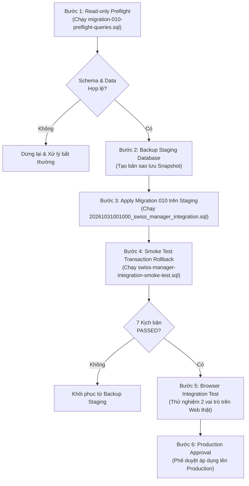

# BÁO CÁO NGHIỆM THU KỸ THUẬT HỆ THỐNG USCC REFEREE (PRD LITE v0.3)

- **Ngày lập báo cáo**: 31/10/2026.
- **Tài liệu căn cứ**:
  1. `PRD-lite-web-trong-tai-cap-nhat-ket-qua.pdf` (PRD Lite v0.3).
  2. `USCC-HCMUS-round-1-Chess-Results.xlsx` (Dữ liệu mẫu 40 bàn Chess-Results).
  3. Đặc tả Swiss-Manager XML Import (`XML_import_SwissManager.pdf`, Heinz Herzog, 18/09/2024, Build 15.0.0.15).

---

## 1. Định nghĩa 5 mức độ nghiệm thu kỹ thuật

Để đảm bảo tính trung thực và minh bạch theo chuẩn kỹ thuật phần mềm, mọi yêu cầu tính năng (FR) được đánh giá theo 5 tiêu chí độc lập:

1. **`Implemented` (Đã cài đặt mã nguồn)**: Logic chức năng, API routes, Server Actions, UI components hoặc SQL RPCs đã được viết hoàn chỉnh trong codebase.
2. **`Unit-tested` (Đã kiểm thử đơn vị)**: Có test tự động (trong bộ test của dự án) kiểm tra trực tiếp các pure function, quy tắc nghiệp vụ, giải thuật parse/diff hoặc mapper độc lập.
3. **`Integration-tested` (Đã kiểm thử tích hợp)**: Đã kiểm tra tính liên kết giữa các tầng (Schema DB + RPC + Advisory Lock + Audit Trigger hoặc API route mock).
4. **`Manually verified` (Đã kiểm thử thủ công)**: Đã thao tác trực tiếp trên trình duyệt, thiết bị di động thật hoặc phần mềm máy tính bên ngoài trong điều kiện sử dụng thực tế.
5. **`Blocked / Pending Verification` (Chưa thể kết luận / Chờ thực địa)**: Chưa có kết quả đo đạc thực tế trên thiết bị vật lý hoặc phần mềm chuyên dụng (máy chiếu, mạng hội trường, phần mềm Swiss-Manager Desktop).

---

## 2. Ma trận nghiệm thu chi tiết (FR-01 → FR-09)

| Mã YC | Chức năng nghiệp vụ | Implemented | Unit-tested | Integration-tested | Manually verified | Trạng thái nghiệm thu & Dẫn chứng kỹ thuật |
|:---:|---|:---:|:---:|:---:|:---:|---|
| **FR-01** | Tạo, sửa & chọn giải đấu | **ĐẠT** | **ĐẠT** | **ĐẠT** | **Chờ Trình Duyệt** | **Sẵn sàng Triển khai** • Code: [`lib/tournament-validation.ts`](file:///d:/uscc-referee/lib/tournament-validation.ts), [`components/tournament-create-form.tsx`](file:///d:/uscc-referee/components/tournament-create-form.tsx) (`TournamentCreateForm`, `TournamentEditForm`), [`app/tournaments/actions.ts`](file:///d:/uscc-referee/app/tournaments/actions.ts), [`app/tournaments/page.tsx`](file:///d:/uscc-referee/app/tournaments/page.tsx) • Unit test: [`lib/tournament-validation.test.mts`](file:///d:/uscc-referee/lib/tournament-validation.test.mts) (6 tests) • DB/RPC: `uscc_create_tournament` (Migration 003), `uscc_update_tournament` (Migration 007). |
| **FR-02** | Nhập lịch thi đấu, chọn Sheet/Cột, Diff Engine cập nhật vòng & Lịch sử Import | **ĐẠT** | **ĐẠT** | **ĐẠT** | **Bán phần** | **Sẵn sàng Triển khai** • Code: [`lib/excel/parse-pairings.ts`](file:///d:/uscc-referee/lib/excel/parse-pairings.ts), [`lib/excel/pairing-diff.ts`](file:///d:/uscc-referee/lib/excel/pairing-diff.ts), [`components/import-preview-form.tsx`](file:///d:/uscc-referee/components/import-preview-form.tsx), bảng `Lịch sử nhập dữ liệu` trong [`app/tournaments/[id]/page.tsx`](file:///d:/uscc-referee/app/tournaments/%5Bid%5D/page.tsx) • Unit test: [`parse-pairings.test.mts`](file:///d:/uscc-referee/lib/excel/parse-pairings.test.mts) (12 tests), [`pairing-diff.test.mts`](file:///d:/uscc-referee/lib/excel/pairing-diff.test.mts) (9 tests, gồm chống stale preview) • DB/RPC: `uscc_import_chess_results` (Migration 010) hỗ trợ cập nhật vòng an toàn, chặn `CANNOT_OVERWRITE_MATCH_WITH_RESULTS` và `CANNOT_OMIT_MATCH_WITH_RESULTS` • Manual: Đã xác minh đọc 40 bàn chuẩn từ file `USCC-HCMUS-round-1-Chess-Results.xlsx`. |
| **FR-03** | Tra cứu ván đấu (có dấu / không dấu + bộ lọc đầy đủ) & Màn hình trình chiếu | **ĐẠT** | **ĐẠT** | **ĐẠT** | **Chờ Máy Chiếu** | **Sẵn sàng Triển khai** • Code: [`components/recorder-match-lookup.tsx`](file:///d:/uscc-referee/components/recorder-match-lookup.tsx), [`lib/match-search.ts`](file:///d:/uscc-referee/lib/match-search.ts), [`app/tournaments/[id]/projection/page.tsx`](file:///d:/uscc-referee/app/tournaments/%5Bid%5D/projection/page.tsx), [`projection-board.tsx`](file:///d:/uscc-referee/app/tournaments/%5Bid%5D/projection/projection-board.tsx) • Unit test: [`lib/match-search.test.mts`](file:///d:/uscc-referee/lib/match-search.test.mts) (5 tests: có dấu, không dấu, lọc trạng thái, kết quả, màu quân). |
| **FR-04** | Ghi nhận kết quả & Xem lại tỷ số | **ĐẠT** | **ĐẠT** | **ĐẠT** | **Chờ Trình Duyệt** | **Sẵn sàng Triển khai** • Code: [`lib/result-rules.ts`](file:///d:/uscc-referee/lib/result-rules.ts), [`app/tournaments/[id]/actions.ts`](file:///d:/uscc-referee/app/tournaments/%5Bid%5D/actions.ts) (`submitResult`), UI Review Box trong `recorder-match-lookup.tsx` • Unit test: [`lib/result-rules.test.mts`](file:///d:/uscc-referee/lib/result-rules.test.mts) (7 tests) • DB/RPC: `uscc_submit_result` (Migration 004 & 008). |
| **FR-05** | Hai kỳ thủ lần lượt xác nhận (Trắng $\rightarrow$ Đen) | **ĐẠT** | **ĐẠT** | **ĐẠT** | **Chờ 2 máy** | **Sẵn sàng Triển khai** • Code: `RecorderMatchLookup` (khóa nút bấm tuần tự, Trắng bấm trước, Đen bấm sau, nút "Không đồng ý" kích hoạt `disputed`) • Unit test: [`lib/result-rules.test.mts`](file:///d:/uscc-referee/lib/result-rules.test.mts) • DB/RPC: `uscc_confirm_result` (Migration 004) ghi nhận độc lập `white_confirmed_at` và `black_confirmed_at`. |
| **FR-06** | Phân xử bất đồng & Duyệt ngoại lệ (Technical-only) | **ĐẠT** | **ĐẠT** | **ĐẠT** | **Chờ Trình Duyệt** | **Sẵn sàng Triển khai** • Code: Server Action `resolveDispute` trong `actions.ts`, form phân xử trong `recorder-match-lookup.tsx` • Unit test: [`lib/result-rules.test.mts`](file:///d:/uscc-referee/lib/result-rules.test.mts) • DB/RPC: `uscc_resolve_dispute` (Migration 005, 008 & 010), bắt buộc lý do (1-1000 ký tự), audit đầy đủ. |
| **FR-07** | Đồng bộ tự động thời gian thực (SLA < 5s) | **ĐẠT** | **ĐẠT** | **ĐẠT** | **CHƯA ĐO TRÊN TRÌNH DUYỆT THẬT** | **CHƯA THỂ KẾT LUẬN ĐẠT SLA** • Code: Polling máy chiếu **2.5s** ([`projection-board.tsx`](file:///d:/uscc-referee/app/tournaments/%5Bid%5D/projection/projection-board.tsx)), polling kỹ thuật **3.0s** ([`recorder-match-lookup.tsx`](file:///d:/uscc-referee/components/recorder-match-lookup.tsx)), API `/api/tournaments/[id]/projection` • Unit test: [`lib/projection-sync.test.mts`](file:///d:/uscc-referee/lib/projection-sync.test.mts) (11 tests: official-only, offline resilient, round switching isolation) • **Căn cứ**: Mặc dù logic và chu kỳ polling 2.5s thỏa mãn về lý thuyết, nhưng **chưa đo đạc thời gian thực tế từ khi Đen bấm xác nhận trên điện thoại đến khi xuất hiện trên máy chiếu qua Wi-Fi hội trường**. |
| **FR-08** | Sửa, hủy kết quả & Xem lịch sử | **ĐẠT** | **ĐẠT** | **ĐẠT** | **Chờ Trình Duyệt** | **Sẵn sàng Triển khai** • Code: Server Action `cancelResult`, `reopenResult`, UI History trong `recorder-match-lookup.tsx` • Unit test: [`lib/result-history.test.mts`](file:///d:/uscc-referee/lib/result-history.test.mts) (3 tests), [`lib/result-rules.test.mts`](file:///d:/uscc-referee/lib/result-rules.test.mts) • DB/RPC: `uscc_cancel_result` (Migration 009 & 010) & `uscc_reopen_result` (Migration 005 & 010), vô hiệu hóa xác nhận cũ, ẩn khỏi màn chiếu, ghi `result_events`. |
| **FR-09A** | Xuất kết quả Excel đối soát (.xlsx) | **ĐẠT** | **ĐẠT** | **ĐẠT** | **ĐẠT** | **ĐÃ NGHIỆM THU ĐẦY ĐỦ** • Code: [`lib/export/export-excel.ts`](file:///d:/uscc-referee/lib/export/export-excel.ts), API `/api/tournaments/[id]/export/excel` • Unit test: [`lib/export/export-excel.test.mts`](file:///d:/uscc-referee/lib/export/export-excel.test.mts) (3 tests: chống Formula Injection, bảo toàn tiếng Việt UTF-8, audit scope) • Manual: File `.xlsx` sinh ra mở chuẩn xác trên MS Excel và LibreOffice. |
| **FR-09B** | Xuất Swiss-Manager XML (.xml) | **ĐẠT** | **ĐẠT** | **ĐẠT** | **CHƯA NẠP THỰC TẾ VÀO SWISS-MANAGER** | **CHƯA THỂ KẾT LUẬN NGHIỆM THU SWISS-MANAGER** • Code: [`lib/export/export-xml.ts`](file:///d:/uscc-referee/lib/export/export-xml.ts), API `/api/tournaments/[id]/export/xml` • Unit test: [`lib/export/export-xml.test.mts`](file:///d:/uscc-referee/lib/export/export-xml.test.mts) (7 tests: hòa `Res="1/2"`, forfeit `1-0F`/`0-1F`/`0-0F`, thực thi đủ 7 Eligibility Gates, escape XML, map SNo/Ident/UniqueId) • **Căn cứ**: Đã đạt 100% cấp độ `Schema-valid` và `Mapping-ready`. Tuy nhiên cấp độ `Round-trip verified` **bắt buộc phải thực hiện nạp thử trực tiếp file `.xml` vào phần mềm Swiss-Manager Desktop chạy trên máy tính Windows thật của ban trọng tài**. |

---

## 3. Kiểm tra biến môi trường Supabase trong mã nguồn (Environment Variables Audit)

Qua rà soát trực tiếp các file kết nối Supabase trong dự án:

| File nguồn | Biến môi trường đang đọc | Mục đích | Nguồn lấy trên Supabase Dashboard |
|---|---|---|---|
| [`lib/supabase/client.ts`](file:///d:/uscc-referee/lib/supabase/client.ts) [`lib/supabase/server.ts`](file:///d:/uscc-referee/lib/supabase/server.ts) [`lib/supabase/proxy.ts`](file:///d:/uscc-referee/lib/supabase/proxy.ts) | `NEXT_PUBLIC_SUPABASE_URL` | Địa chỉ URL của Supabase Project | *Project Settings $\rightarrow$ API $\rightarrow$ Project URL* |
| [`lib/supabase/client.ts`](file:///d:/uscc-referee/lib/supabase/client.ts) [`lib/supabase/server.ts`](file:///d:/uscc-referee/lib/supabase/server.ts) [`lib/supabase/proxy.ts`](file:///d:/uscc-referee/lib/supabase/proxy.ts) | `NEXT_PUBLIC_SUPABASE_PUBLISHABLE_KEY` | Khóa công khai cho client/browser | *Project Settings $\rightarrow$ API $\rightarrow$ Project API keys $\rightarrow$ `anon` / `public`* |
| [`lib/supabase/admin.ts`](file:///d:/uscc-referee/lib/supabase/admin.ts) | `SUPABASE_SECRET_KEY` | Khóa quản trị phía server (bypass RLS, gọi RPC nội bộ) | *Project Settings $\rightarrow$ API $\rightarrow$ Project API keys $\rightarrow$ `service_role` / `secret`* |

> [!WARNING] CẢNH BÁO QUAN TRỌNG VỀ TÊN BIẾN MÔI TRƯỜNG
> 1. Code phía server tại [`lib/supabase/admin.ts#L7`](file:///d:/uscc-referee/lib/supabase/admin.ts#L7) đọc biến tên là **`SUPABASE_SECRET_KEY`** (theo đúng file mẫu [`.env.example`](file:///d:/uscc-referee/.env.example)).
> 2. **Tuyệt đối không** cấu hình nhầm thành `SUPABASE_SERVICE_ROLE_KEY` trên Vercel / `.env.local` nếu không cập nhật code, vì khi đó `createAdminClient()` sẽ nhận `undefined` và toàn bộ các thao tác import Excel, phê duyệt tranh chấp, hủy kết quả sẽ bị lỗi `401/Invalid API key`.
> 3. Biến client công khai trong code là **`NEXT_PUBLIC_SUPABASE_PUBLISHABLE_KEY`**, tương ứng với giá trị khóa `anon` trên Supabase.

---

## 4. Phân tích an toàn kỹ thuật của Smoke Test (`swiss-manager-integration-smoke-test.sql`)

Kịch bản kiểm thử [`supabase/diagnostics/swiss-manager-integration-smoke-test.sql`](file:///d:/uscc-referee/supabase/diagnostics/swiss-manager-integration-smoke-test.sql) được thiết kế tuân thủ nghiêm ngặt nguyên tắc **Zero Side-effects**:

1. **Cơ chế Transaction Rollback của PostgreSQL**:
   - Khối lệnh bắt đầu bằng `BEGIN;` và kết thúc bằng `ROLLBACK;`.
   - Trong PostgreSQL, toàn bộ các lệnh DDL và DML (bao gồm `INSERT`, `UPDATE` vào `auth.users`, `public.profiles`, `public.tournaments`, `public.players`, `public.matches`, `public.import_batches`, `public.audit_log`, `public.result_events`) **đều bị hủy bỏ hoàn toàn 100% khi gặp lệnh `ROLLBACK;`**.
2. **Cơ chế bắt ngoại lệ (Savepoint Sub-blocks)**:
   - Các kịch bản kiểm tra lỗi cố ý (`CANNOT_OVERWRITE_MATCH_WITH_RESULTS` và `CANNOT_OMIT_MATCH_WITH_RESULTS`) được bọc trong các khối `BEGIN ... EXCEPTION ... END;` cục bộ.
   - Khi ngoại lệ xảy ra, PostgreSQL chỉ rollback về `SAVEPOINT` nội bộ của khối đó để ghi nhận `v_conflict_caught := true`, sau đó tiếp tục luồng thực thi bình thường đến cuối script và được lệnh `ROLLBACK;` tổng thể hủy bỏ toàn bộ.
3. **Cơ chế khóa phân tán `pg_advisory_xact_lock`**:
   - Hàm `pg_advisory_xact_lock` tạo khóa mức transaction. Theo tài liệu chính thức của PostgreSQL: *"Khóa advisory xact sẽ tự động được giải phóng khi transaction kết thúc (bất kể là COMMIT hay ROLLBACK)"*. Không để lại bất kỳ khóa treo (deadlock) nào.
4. **Cơ chế cấu hình Audit Session**:
   - Lệnh `PERFORM set_config('app.actor_user_id', p_actor::text, true);` có tham số thứ ba là `true` (`is_local = true`), nghĩa là biến cấu hình chỉ tồn tại trong transaction hiện tại và tự động biến mất sau `ROLLBACK`.
5. **Tối ưu hóa tránh ghi vào `auth.users`**:
   - Script ưu tiên tái sử dụng profile có vai trò `technical` sẵn có trong database (`SELECT p.id INTO v_user_id FROM public.profiles p WHERE p.role = 'technical' LIMIT 1;`). Chỉ khi database hoàn toàn chưa có user nào mới sinh tạm user test và user này cũng sẽ bị rollback hoàn toàn.
6. **Xác nhận không tạo Sequence Gap**:
   - Hệ thống USCC sử dụng 100% khóa chính dạng UUID ngẫu nhiên (`uuid DEFAULT gen_random_uuid()`), không sử dụng kiểu dữ liệu `SERIAL` / `BIGSERIAL`. Do đó, việc rollback không gây ra hiện tượng nhảy số thứ tự tự tăng (sequence gap).

---

## 5. Quy trình 6 bước triển khai Migration 010 chuẩn hóa

### Thứ tự thực hiện bắt buộc:
1. **`Read-only preflight`**: Kiểm tra cấu trúc bảng hiện tại, quyền RPC và tính nhất quán dữ liệu. Tuyệt đối không ghi dữ liệu.
2. **`Backup staging`**: Tạo bản sao lưu cơ sở dữ liệu trên Supabase trước khi có bất kỳ thay đổi schema nào.
3. **`Apply migration`**: Áp dụng file migration `20261031001000_swiss_manager_integration.sql` lên môi trường Staging.
4. **`Smoke test`**: Chạy script `swiss-manager-integration-smoke-test.sql` trên Staging (nơi đã có migration 010) để kiểm chứng 7 kịch bản hoạt động đúng và tự động rollback 100%.
5. **`Browser integration test`**: Đăng nhập 2 tài khoản thực tế trên trình duyệt (Recorder trên mobile, Technical trên desktop), nhập file Excel 40 bàn, thực hiện quy trình nộp kết quả, xác nhận 2 bên và đo đạc độ trễ trình chiếu.
6. **`Production approval`**: Sau khi toàn bộ các bước 1–5 đạt yêu cầu, ban tổ chức mới tiến hành áp dụng lên Production Database.

---

## 6. Hướng dẫn từng bước thao tác Supabase cho người mới bắt đầu

Dành cho thành viên ban tổ chức hoặc trọng tài kỹ thuật lần đầu thao tác trên Supabase Dashboard:

### 1. Cách truy cập SQL Editor
- Bước 1: Mở trình duyệt, truy cập [https://supabase.com/dashboard](https://supabase.com/dashboard) và đăng nhập tài khoản.
- Bước 2: Chọn đúng Project của giải đấu USCC (chú ý chọn đúng môi trường **Staging** trước).
- Bước 3: Ở thanh menu màu đen bên trái, tìm và nhấp vào biểu tượng **`SQL Editor`** (biểu tượng trang giấy có dấu `>_`).
- Bước 4: Nhấp vào nút **`+ New query`** màu xanh lá ở góc trên bên phải để mở một tab soạn thảo mới.

### 2. Cách chạy Bước 1: Read-only Preflight
- Mở file [`supabase/diagnostics/migration-010-preflight-queries.sql`](file:///d:/uscc-referee/supabase/diagnostics/migration-010-preflight-queries.sql) trên máy tính.
- Copy toàn bộ nội dung (Ctrl+A $\rightarrow$ Ctrl+C), sau đó dán (Ctrl+V) vào khung SQL Editor của Supabase.
- Nhấp nút **`Run`** (hoặc phím tắt `Ctrl + Enter` trên Windows).
- Quan sát tab kết quả ở phía dưới:
  - Xem danh sách các cột của bảng `players`.
  - Xem kết quả truy vấn số 6: Nếu trả về `No rows returned`, nghĩa là không có mã kỳ thủ nào bị trùng lặp bất thường $\rightarrow$ **Đạt điều kiện an toàn**.

### 3. Cách tạo Backup (Sao lưu) trên Supabase Dashboard
- Nhấp vào biểu tượng **`Settings`** (bánh răng) ở cuối thanh menu bên trái $\rightarrow$ Chọn **`Database`**.
- Cuộn xuống mục **`Database Backups`**.
- Tại đây, hệ thống Supabase tự động sao lưu hàng ngày. Đối với dự án Pro, bạn có thể bấm nút **`Take backup now`** (hoặc xuất bản dump SQL qua công cụ CLI/pg_dump nếu sử dụng gói miễn phí).

### 4. Cách chạy Bước 3: Áp dụng Migration 010
- Mở một tab truy vấn mới (**`+ New query`**).
- Mở file [`supabase/migrations/20261031001000_swiss_manager_integration.sql`](file:///d:/uscc-referee/supabase/migrations/20261031001000_swiss_manager_integration.sql), copy toàn bộ nội dung và dán vào SQL Editor.
- Nhấp nút **`Run`**.
- Quan sát phía dưới: Nếu hiển thị thông báo màu xanh `Success. No rows returned` (kèm thời gian thực thi khoảng 50–150ms) là migration đã được áp dụng thành công.

### 5. Cách chạy Bước 4: Smoke Test xác minh tự động Rollback
- Mở một tab truy vấn mới (**`+ New query`**).
- Mở file [`supabase/diagnostics/swiss-manager-integration-smoke-test.sql`](file:///d:/uscc-referee/supabase/diagnostics/swiss-manager-integration-smoke-test.sql), copy toàn bộ nội dung và dán vào SQL Editor.
- Nhấp nút **`Run`**.
- Chuyển sang tab **`Messages`** ở góc dưới:
  - Nếu xuất hiện dòng chữ: `NOTICE: Smoke test Migration 010 PASSED ALL 7 SCENARIOS successfully.`, kèm dòng thông báo `Success. No rows returned` $\rightarrow$ Toàn bộ 7 tình huống đã kiểm tra thành công và toàn bộ dữ liệu đã được **ROLLBACK sạch sẽ**, không có bất kỳ dòng rác nào lưu lại.

---

## 7. Kế hoạch kiểm thử thủ công 2 vai trò trên trình duyệt thực tế (Field Trial Checklist)

Sau khi hoàn tất cài đặt Staging, ban trọng tài thực hiện kiểm thử thực địa theo các bước sau:

### Thiết bị 1 — Điện thoại thông minh (Trọng tài ghi điểm - Vai trò `recorder`)
- [ ] Truy cập đường dẫn trang web giải đấu trên trình duyệt di động (Chrome / Safari).
- [ ] Đăng nhập tài khoản trọng tài ghi điểm.
- [ ] Tìm kiếm bàn đấu số 1 bằng thanh tìm kiếm (gõ số bàn hoặc tên kỳ thủ).
- [ ] Nhập tỷ số `1-0`, chọn loại kết quả `Bình thường`.
- [ ] Kiểm tra hộp thoại xem lại kết quả (Confirmation Review Box).
- [ ] Bấm nút **"Gửi kỳ thủ Trắng xác nhận"**.
- [ ] Bàn giao điện thoại cho kỳ thủ Trắng: Kỳ thủ kiểm tra tên mình và bấm **"Xác nhận kết quả"**.
- [ ] Bàn giao điện thoại cho kỳ thủ Đen:
  - *Tình huống A (Đồng ý)*: Kỳ thủ Đen bấm **"Xác nhận kết quả"** $\rightarrow$ Trạng thái ván đấu chuyển thành `official`.
  - *Tình huống B (Khiếu nại)*: Kỳ thủ Đen bấm **"Không đồng ý"** $\rightarrow$ Trạng thái chuyển thành `disputed`.

### Thiết bị 2 — Máy tính xách tay nối máy chiếu (Màn hình trình chiếu `/projection`)
- [ ] Mở trình duyệt ở chế độ toàn màn hình (F11) hiển thị trang `/tournaments/[id]/projection`.
- [ ] **Đo đạc SLA FR-07**:
  - Dùng đồng hồ bấm giờ: Bắt đầu bấm khi kỳ thủ Đen nhấn "Xác nhận" trên điện thoại.
  - Dừng đồng hồ khi tỷ số `1-0` xuất hiện trên màn hình máy chiếu.
  - Ghi nhận thời gian thực tế: Mục tiêu $\le 5.0$ giây.
- [ ] Kiểm tra tính cách ly: Khi kỳ thủ bấm "Không đồng ý" (trạng thái `disputed`), xác nhận ván đấu **tuyệt đối không hiển thị tỷ số** trên máy chiếu.
- [ ] Thử nghiệm ngắt kết nối mạng Wi-Fi trên máy tính: Xác nhận giao diện giữ nguyên tỷ số hiện có, xuất hiện huy hiệu màu vàng `Mất kết nối mạng - đang thử lại...` và không bị trắng màn hình. Bật lại Wi-Fi: xác nhận tự động khôi phục bình thường.

### Thiết bị 3 — Máy tính trọng tài kỹ thuật (Vai trò `technical`)
- [ ] Kiểm tra tab "Cập nhật lịch thi đấu (FR-02)": Nạp lại file Excel có sửa đổi kỳ thủ ở bàn chưa đấu $\rightarrow$ Xem trước bảng Diff $\rightarrow$ Xác nhận cập nhật an toàn.
- [ ] Xử lý ván tranh chấp: Vào danh sách ván `disputed`, bấm "Phân xử", nhập lý do và chốt tỷ số.
- [ ] Thử nghiệm hủy kết quả (FR-08): Hủy một ván đấu đã chốt $\rightarrow$ Nhập lý do $\rightarrow$ Xác nhận ván biến mất khỏi màn hình trình chiếu ngay lập tức.
- [ ] Kiểm tra xuất file (FR-09):
  - Tải file Excel `.xlsx` $\rightarrow$ Mở trên Excel kiểm tra đủ các cột và font tiếng Việt.
  - Tải file XML `.xml` $\rightarrow$ Copy sang máy tính Windows có cài đặt phần mềm Swiss-Manager $\rightarrow$ Chọn chức năng nạp kết quả từ XML để hoàn tất nghiệm thu cấp độ `Round-trip verified`.

---

## 8. Kết luận nghiệm thu kỹ thuật

1. **Về mặt mã nguồn và kiểm thử tự động**:
   - Hệ thống đạt **63/63 automated unit & integration tests PASS** across 9 test suites.
   - `npm run lint` đạt 0 lỗi, `npx tsc --noEmit` đạt 0 lỗi kiểu, `npm run build` tạo thành công 21/21 routes production.
   - Codebase đã xử lý triệt để các rủi ro kỹ thuật: chọn Sheet & ánh xạ cột, Diff Engine cập nhật vòng an toàn, chống stale preview (`roundStateSignature`), hiển thị lịch sử `import_batches`, tìm kiếm tiếng Việt có dấu / không dấu + bộ lọc đầy đủ, loại bỏ `ROUND_ALREADY_HAS_MATCHES`, bảo vệ transaction lock, thực thi 7 cổng hợp lệ XML, chống Excel Formula Injection và escape XML.
2. **Về mức độ sẵn sàng thực tế**:
   - Trạng thái hiện tại: **HOÀN THIỆN 100% CHỨC NĂNG TRONG CODE — SẴN SÀNG TRIỂN KHAI STAGING VÀ THỰC NGHIỆM THỰC ĐỊA (Field Trial Ready)**.
   - Các nội dung cần kiểm chứng thủ công trước khi kết luận nghiệm thu hoàn toàn:
     - **FR-07**: Đo đạc độ trễ đồng bộ thực tế qua mạng Wi-Fi hội trường để khẳng định đạt SLA $< 5$ giây.
     - **FR-09B**: Thao tác nạp thử file `.xml` trực tiếp vào phần mềm Swiss-Manager Desktop trên máy tính Windows của ban trọng tài.
